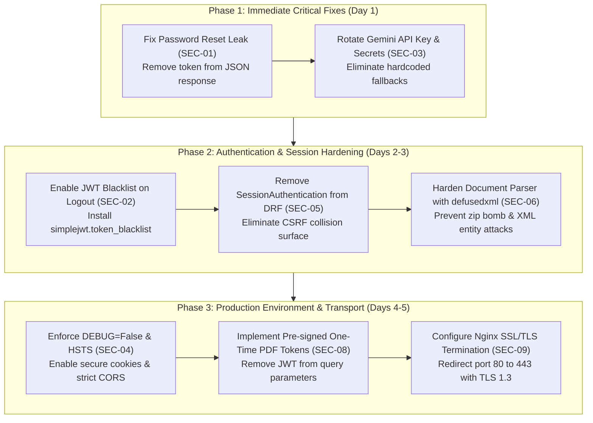

# Roo4Tech Smart CRM — Comprehensive Security Audit & Hardening Plan

**Audit Date:** November 2026  
**Target:** Root4Tech Smart CRM (Django REST Framework Backend + Next.js 15 Frontend)  
**Standard:** OWASP Top 10 (2021), CWE/SANS Top 25, NIST Cybersecurity Framework  

---

## Executive Summary

A comprehensive architectural and source code security assessment was performed across the **Root4Tech Smart CRM** ecosystem. The audit analyzed authentication, authorization, session lifecycle, data validation, object-level access controls (IDOR), API integrations, AI assistant tool calling, frontend XSS surface, container configurations, and production network deployment settings.

### Overall Security Posture
- **Strengths**: 
  - Strong role-based access control (RBAC) foundation across models.
  - Object-level query filtering in most ViewSets prevents unauthorized data discovery.
  - Two-phase consequential action proposals (`ActionProposal`) with signed tokens successfully mitigate unauthorized AI tool execution.
  - Robust database transaction wrapping (`transaction.atomic()`) for financial payments and lead conversions.
  - No direct XSS sinks (`eval`, `dangerouslySetInnerHTML`) found in frontend code.
- **Vulnerabilities Identified**:
  - **1 Critical**: Password reset token leakage in HTTP response (instant account takeover).
  - **2 High**: Missing JWT revocation/blacklist on logout; plaintext API keys & default fallback secrets.
  - **3 Medium**: Production deployment flags (`DEBUG=True`, disabled security headers); global SessionAuthentication CSRF side-effects; XML entity / Zip Bomb vectors in document parsing.
  - **3 Low / Defense-in-Depth**: JWT in `localStorage`; JWT in PDF URL query parameters; prompt injection resilience.

---

## Vulnerability Classification Matrix

| ID | Vulnerability Title | Severity | OWASP / CWE | Status |
| :--- | :--- | :--- | :--- | :--- |
| **SEC-01** | Password Reset Token Leaked in API Response | **CRITICAL** | CWE-640 / A07:2021 | Requires Immediate Fix |
| **SEC-02** | JWT Token Invalidation Bypassed on Logout | **HIGH** | CWE-613 / A01:2021 | Requires Fix |
| **SEC-03** | Plaintext API Keys & Insecure Default Fallback Secrets | **HIGH** | CWE-798 / A02:2021 | Requires Fix |
| **SEC-04** | `DEBUG=True` & Missing Production Security Headers | **MEDIUM** | CWE-1188 / A05:2021 | Configuration Fix |
| **SEC-05** | DRF `SessionAuthentication` CSRF Vulnerability Surface | **MEDIUM** | CWE-352 / A01:2021 | Architectural Fix |
| **SEC-06** | XML Entity / Zip Bomb Risk in Document Parsing | **MEDIUM** | CWE-776 / CWE-409 | Defense-in-Depth |
| **SEC-07** | JWT Stored in Browser `localStorage` (XSS Exposure) | **MEDIUM** | CWE-922 / A04:2021 | Architectural Enhancement |
| **SEC-08** | Sensitive JWT Passed in PDF Download Query Strings | **LOW** | CWE-598 / A02:2021 | Hardening Fix |
| **SEC-09** | Nginx SSL/TLS Missing & Unrestricted HTTP Port 80 | **LOW** | CWE-319 / A05:2021 | Deployment Fix |

---

## Detailed Vulnerability Analysis

### SEC-01 [CRITICAL]: Password Reset Token Leaked in API Response
- **Vulnerability Type:** Weak Password Recovery Mechanism (CWE-640)
- **Source Location:** [backend/apps/accounts/views.py](file:///e:/Root4tech-CRM/backend/apps/accounts/views.py#L140-L143)
- **Mechanics:**
  In `PasswordResetRequestView`:
  ```python
  # In production this would send an email; in dev/testing we return token for confirmation flow
  return Response({
      'message': 'Password reset instructions have been generated.',
      'token': token  # <-- CRITICAL LEAK
  }, status=status.HTTP_200_OK)
  ```
- **Impact:** An unauthenticated attacker can supply any user's email (e.g. `admin@roo4tech.com`) to `/api/auth/password-reset/`. The server generates the reset token and returns it directly in the HTTP JSON response. The attacker then submits `/api/auth/password-reset/confirm/` with the stolen token and resets the password, taking over any account without accessing the victim's email inbox.
- **Remediation:** Remove `'token'` from the HTTP response. Send the token exclusively via email using Django's email backend.

---

### SEC-02 [HIGH]: JWT Token Invalidation Bypassed on Logout
- **Vulnerability Type:** Insufficient Session Expiration (CWE-613)
- **Source Location:** [backend/apps/accounts/views.py](file:///e:/Root4tech-CRM/backend/apps/accounts/views.py#L55-L68) & [backend/core/settings.py](file:///e:/Root4tech-CRM/backend/core/settings.py#L233-L239)
- **Mechanics:**
  The `LogoutView` endpoint merely records an audit log and returns HTTP 200 without blacklisting the token. Furthermore, `BLACKLIST_AFTER_ROTATION` is set to `False` in `SIMPLE_JWT`, and `rest_framework_simplejwt.token_blacklist` is omitted from `INSTALLED_APPS`.
- **Impact:** When a user logs out, their access token remains valid for 2 hours, and their refresh token remains valid for 7 days. If a device is shared or an attacker intercepted the token, logging out provides zero protection.
- **Remediation:**
  1. Add `'rest_framework_simplejwt.token_blacklist'` to `INSTALLED_APPS`.
  2. Set `'BLACKLIST_AFTER_ROTATION': True` in `SIMPLE_JWT`.
  3. Require the client to send the refresh token in `/api/auth/logout/` and invoke `RefreshToken(token).blacklist()`.

---

### SEC-03 [HIGH]: Plaintext API Keys & Insecure Default Fallback Secrets
- **Vulnerability Type:** Use of Hard-coded Credentials (CWE-798)
- **Source Location:** [backend/.env](file:///e:/Root4tech-CRM/backend/.env#L15), [docker-compose.yml](file:///e:/Root4tech-CRM/docker-compose.yml#L11), [backend/core/settings.py](file:///e:/Root4tech-CRM/backend/core/settings.py#L12)
- **Mechanics:**
  - A live Gemini API key is stored in plaintext in `backend/.env`.
  - Fallback `SECRET_KEY = os.getenv('SECRET_KEY', 'django-insecure-roo4tech-crm-default-key-2026-phase1')` allows Django to run with a known public secret if `.env` fails to load.
  - Fallback `POSTGRES_PASSWORD: ${POSTGRES_PASSWORD:-SecureDatabasePassword123!}` in `docker-compose.yml`.
- **Impact:** If `SECRET_KEY` is known, an attacker can forge signed cookies, bypass CSRF tokens, and tamper with cryptographic hashes. An exposed Gemini key allows unauthorized API usage and potential quota exhaustion.
- **Remediation:**
  1. In `core/settings.py`, disallow insecure fallback: if `SECRET_KEY` is missing in non-debug mode, fail immediately on boot.
  2. Rotate the Gemini API key in Google AI Studio.
  3. Ensure `.env` is never committed (verified in `.gitignore`).

---

### SEC-04 [MEDIUM]: `DEBUG=True` & Missing Production Security Headers
- **Vulnerability Type:** Incorrect Default Permissions / Security Misconfiguration (CWE-1188)
- **Source Location:** [backend/.env](file:///e:/Root4tech-CRM/backend/.env#L2), [backend/core/settings.py](file:///e:/Root4tech-CRM/backend/core/settings.py#L255-L266)
- **Mechanics:**
  - `DEBUG=True` in `.env` triggers:
    - `CORS_ALLOW_ALL_ORIGINS = True`
    - `ALLOWED_HOSTS = ['*']`
    - Full traceback and environment inspection in browser on 500 errors.
  - Security headers (`X-Frame-Options`, `HSTS`, `SECURE_CONTENT_TYPE_NOSNIFF`, `CSRF_COOKIE_SECURE`) are disabled when `DEBUG=True`.
- **Impact:** Leaks sensitive database schemas, backend directory structures, and environment parameters to any client provoking an error.
- **Remediation:** Configure `DEBUG=False` for production deployments and enforce HSTS (`SECURE_HSTS_SECONDS = 31536000`).

---

### SEC-05 [MEDIUM]: DRF `SessionAuthentication` CSRF Vulnerability Surface
- **Vulnerability Type:** Cross-Site Request Forgery (CSRF) (CWE-352)
- **Source Location:** [backend/core/settings.py](file:///e:/Root4tech-CRM/backend/core/settings.py#L209-L212)
- **Mechanics:**
  `DEFAULT_AUTHENTICATION_CLASSES` includes both `JWTAuthentication` and `SessionAuthentication`.
- **Impact:** If an authenticated admin visits the Django Admin (`/admin`), a session cookie is issued. If they then visit an external malicious webpage that issues AJAX requests to the CRM API, DRF will accept the browser's session cookie unless CSRF tokens are present. Furthermore, legitimate frontend requests with JWT can intermittently fail with `403 CSRF Failed` when a session cookie is present.
- **Remediation:** Remove `'rest_framework.authentication.SessionAuthentication'` from `DEFAULT_AUTHENTICATION_CLASSES`. Pure API routes should exclusively use `JWTAuthentication`.

---

### SEC-06 [MEDIUM]: XML Entity & Zip Bomb Risk in Document Parsing
- **Vulnerability Type:** Improper Restriction of XML External Entity Reference (CWE-776) / Uncontrolled Resource Consumption (CWE-409)
- **Source Location:** [backend/apps/assistant/services/document_parser.py](file:///e:/Root4tech-CRM/backend/apps/assistant/services/document_parser.py#L51-L60)
- **Mechanics:**
  The `.docx` parser reads `word/document.xml` using `docx_zip.read()` and parses it with standard `xml.etree.ElementTree.fromstring()`.
- **Impact:**
  - A compressed zip bomb (e.g. 50 KB zip that decompresses to 2 GB XML) can exhaust server RAM, triggering an Out-Of-Memory (OOM) worker kill.
  - Standard `ElementTree` lacks defense against entity expansions and quadratic blowup attacks.
- **Remediation:** Check uncompressed entry sizes in `ZipInfo` before reading. Replace standard `xml.etree.ElementTree` with `defusedxml.ElementTree`.

---

### SEC-07 [MEDIUM]: JWT Token Storage in Browser `localStorage`
- **Vulnerability Type:** Insecure Storage of Sensitive Information (CWE-922)
- **Source Location:** [frontend/src/lib/api.ts](file:///e:/Root4tech-CRM/frontend/src/lib/api.ts#L33-L45)
- **Mechanics:**
  The frontend stores `roo4tech_access_token` and `roo4tech_refresh_token` in `window.localStorage`.
- **Impact:** Any script running in the browser context (from an XSS vulnerability, rogue browser extension, or compromised npm package) can access `localStorage` and exfiltrate user credentials.
- **Remediation:** Transition authentication tokens to `HttpOnly`, `Secure`, `SameSite=Strict` cookies.

---

### SEC-08 [LOW]: Sensitive JWT Passed in PDF Download Query Strings
- **Vulnerability Type:** Sensitive Information in URL (CWE-598)
- **Source Location:** [backend/apps/quotations/views.py](file:///e:/Root4tech-CRM/backend/apps/quotations/views.py#L110-L122), [backend/apps/invoices/views.py](file:///e:/Root4tech-CRM/backend/apps/invoices/views.py#L108-L120)
- **Mechanics:**
  To download or preview PDFs in an iframe or new browser tab, the frontend appends `?token=<jwt_access_token>` to the URL.
- **Impact:** Full access tokens appear in web server access logs, browser history, and proxy cache logs.
- **Remediation:** Replace long-lived JWTs in URLs with short-lived (e.g. 60-second), single-use pre-signed download tokens scoped strictly to the requested PDF document ID.

---

### SEC-09 [LOW]: Missing TLS/HTTPS Configuration in Reverse Proxy
- **Vulnerability Type:** Cleartext Transmission of Sensitive Information (CWE-319)
- **Source Location:** [nginx/nginx.conf](file:///e:/Root4tech-CRM/nginx/nginx.conf#L34-L37)
- **Mechanics:**
  Nginx only binds to port 80 (HTTP). Port 443 is exposed in `docker-compose.yml` but has no corresponding SSL certificate block in `nginx.conf`.
- **Impact:** If deployed without a cloud SSL proxy (like Cloudflare or AWS ALB), credentials and customer CRM data are transmitted in cleartext.
- **Remediation:** Add SSL certificate configuration (`ssl_certificate`, `ssl_certificate_key`) with modern TLS 1.2/1.3 ciphers, and redirect HTTP (port 80) to HTTPS (port 443).

---

## Step-by-Step Security Hardening Plan



### Action Checklist

#### Immediate Actions:
- [ ] **SEC-01**: Edit [backend/apps/accounts/views.py](file:///e:/Root4tech-CRM/backend/apps/accounts/views.py) to remove the `'token'` field from `PasswordResetRequestView` response.
- [ ] **SEC-03**: Rotate the `GEMINI_API_KEY` in Google AI Studio and update [backend/.env](file:///e:/Root4tech-CRM/backend/.env).
- [ ] **SEC-03**: Update [backend/core/settings.py](file:///e:/Root4tech-CRM/backend/core/settings.py) to raise a `ValueError` if `SECRET_KEY` is unconfigured when `DEBUG=False`.

#### Next Actions:
- [ ] **SEC-02**: Add `'rest_framework_simplejwt.token_blacklist'` to `INSTALLED_APPS` and update `LogoutView` to blacklist refresh tokens.
- [ ] **SEC-05**: Remove `'rest_framework.authentication.SessionAuthentication'` from `DEFAULT_AUTHENTICATION_CLASSES`.
- [ ] **SEC-06**: Add `defusedxml` to `backend/requirements.txt` and validate uncompressed file sizes in `document_parser.py`.
- [ ] **SEC-08**: Implement single-use pre-signed tokens for PDF downloads.
- [ ] **SEC-09**: Configure SSL certificates in `nginx/nginx.conf`.

---

*Security assessment conducted for Roo4Tech Smart CRM.*

